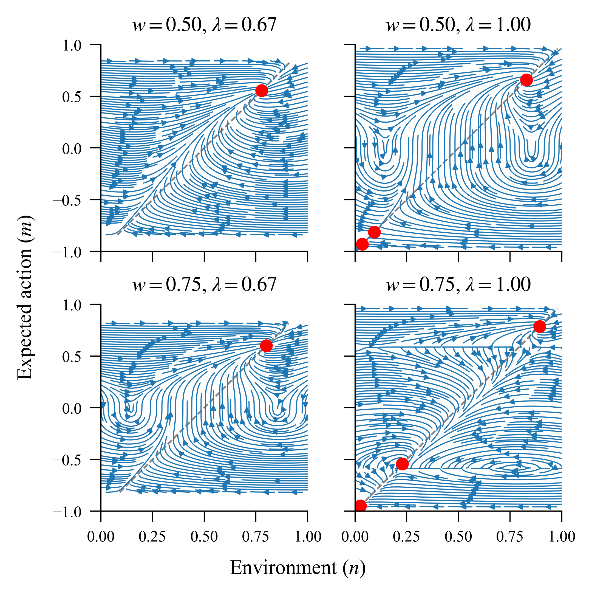

# Individual Decision-Making in Coupled Agent-Environment Systems

This repository contains the agent-based model implementation and experiments supporting the corresponding
report into individual climate-related decision-making in coupled human-environment dynamical systems.

     
    <em>Fig 1: Emergence of clustering environment level across time.</em>

     
    <em>Fig 2: Mean field phase portraits for different agent rationality levels and social norm weight.</em>

To contribute to this project, or reproduce our results, see the project documentation available at 
[victorianhues.github.io/AgentBasedModeling](https://victorianhues.github.io/AgentBasedModeling/).

## Quick reference
- **Installation**: Clone the repository and install dependencies with `uv sync` (recommended) or `pip install -r requirements.txt`.
- **Run all experiments**: Use `make -j` for quick/approximate results (includes CCDF gamma sweep 0.0041, 0.0045, 0.0049), or `QUALITY=high make -j` for report-quality settings.
- **Report-focused phase transition analysis**: Use `make phase-transition-analysis`.
- **Run all predefined phase-transition configurations**: Use `make phase-transition-all-configurations`.
- **Run CCDF gamma sweep (0.0041, 0.0045, 0.0049)**: Use `make powerlaw-spatial-corr-gamma-sweep`.
- **Inspect configurable report settings**: Use `make help`.
- **Control simulation worker count**: Add `ABM_MAX_WORKERS=<n>` (and optionally `ABM_CHUNKSIZE=<n>`) to your make command.
- **Example custom sweep configuration**: `make temporal-autocorr-susceptibility QUALITY=high CONST_PEER=1 NEIGHBORHOOD_PREDICTION=linear GAMMA_S_STEPS=25 RATIONALITY_STEPS=25`.
- **Contributing**: Follow the guidelines in the [documentation](https://victorianhues.github.io/AgentBasedModeling/contributing.html).

## Authors

Victoria Peterson - 15476758

Karolina Chłopicka - 15716546

Henry Zwart - 15393879

Shania Sinha - 14379031

## License

This project is licensed under the MIT License. See the [LICENSE](LICENSE) file for more details.
